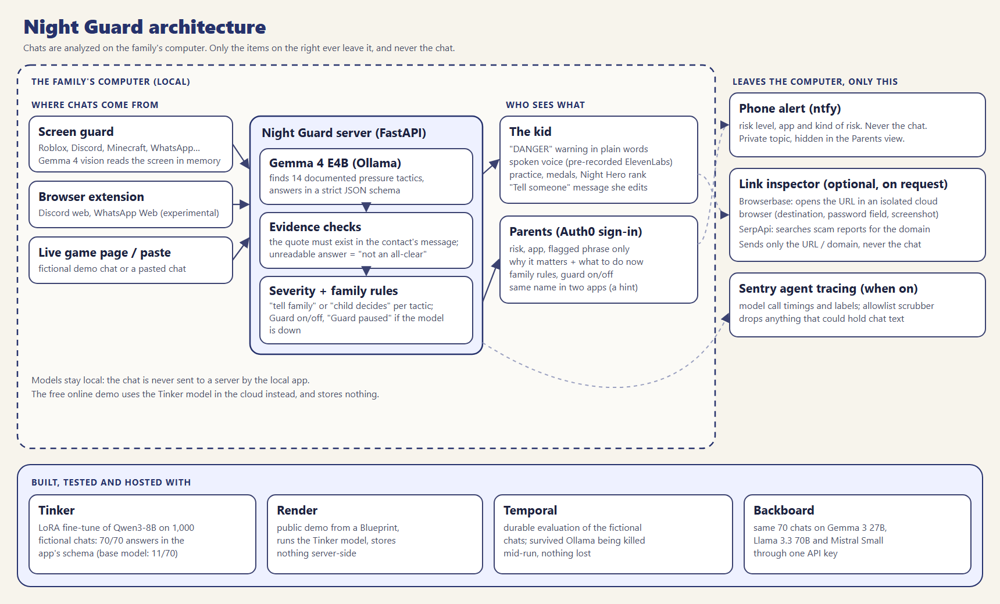

# 🛡️🌙 Night Guard

**Helps kids understand what happened in an online chat, and choose how to ask for help.**
Runs on the child's own computer with **Gemma** (Google's open-weight model) through Ollama.
Chat analysis stays on the device in local mode. Optional link checks send the selected URL to external services.

> Existing tools watch kids. Night Guard watches out *for* them.

**Try the online demo:** https://night-guard-demo.onrender.com
(fictional examples only; it runs the Tinker fine-tuned model in the cloud so anyone can try it. The real app runs
on the child's computer with Gemma. Free instance: the first visit after a quiet period takes ~50 s to wake up.)

> ## 🚧 Next step: mobile apps and in-game chat
> Today, on a **Windows computer**, Night Guard reacts **on its own, as messages arrive**: a Chrome extension
> watches web chats (Discord web, WhatsApp Web, experimental), and a **screen guard** uses Gemma's vision to read the
> chat inside **installed apps** like the Roblox and Discord apps, all on-device.
> **It does not yet protect phones.** On **Android**, the plan is an app that reads message notifications
> (the same permission parental tools use there) and runs the detector on-device. On **iPhone**, Apple doesn't let
> any app read other apps' messages, so the realistic path is working with Apple's own Communication Safety.
> Bringing Night Guard to the phone, where most kids chat, is the project's next milestone.

## What it does

| Screen | What happens |
|---|---|
| **Something felt off** | Paste a chat. Before showing results, Night Guard asks *"did anything feel off to you?"*, then highlights the exact phrases that match common pressure tricks (secrecy, moving to another app, free-stuff links, password requests…) with a calm one-line explanation. If nothing is found, it says so, and reminds the child that their feeling still counts. |
| **Practice** | Short, pre-reviewed fictional scenarios (fake moderator, free Robux link, "don't tell your parents"). Choose a reply, then see why it works or not. |
| **Tell someone** | Pick which quotes to share, and Gemma drafts a short, editable message to a trusted adult ("I didn't do anything wrong, but I need help"). Nothing is sent automatically. |
| **Family** | Kids don't always recognize a bad intention, so parents set **family rules**: which signals are shared with them automatically (default: photo requests, meeting in person, password requests, secrecy, and any high-risk combination). The child is always told when that happens. Parents see the risk type, the app and the flagged phrase, never the whole chat. |

### Proactive: it doesn't wait for the child to paste anything

Pressure can escalate during a chat session. Night Guard can check messages as they arrive, without waiting for
the child to paste a conversation. The live overlay sends the **12 most recent messages** to each check:

- **Live demo:** open `/game` (also on the online demo): a fictional game chat where a stranger writes and Night Guard
  reacts on its own.
- **Chrome extension** (`extension/`): load it unpacked (`chrome://extensions` → Developer mode → Load unpacked →
  pick the `extension` folder). It reads new messages on Discord web and WhatsApp Web (experimental) and sends them
  **only to the local server** (`http://localhost:...`); the extension refuses any non-local address. A
  "🛡️ Guard on" badge is always visible, so the child knows the guard is there.

- **Screen guard for installed apps** (`guard/screen_guard.py`, Windows): web chats are only half of it, because
  kids chat inside the **Roblox app, the Discord app, Minecraft, TikTok**. Every few seconds, if the window in
  front is one of those apps, Night Guard takes a screenshot of that window **in memory**, and **Gemma's vision**
  reads the chat locally. The text goes to the same detector; the image is never saved and never leaves the
  computer. Any other window (bank, email, school) is never captured. Run:
  `python -m guard.screen_guard --server http://localhost:8765 --lang en --me <child's username>`

### What the child sees vs. what the family sees

| | Child | Family |
|---|---|---|
| Tone | Plain words, says **"DANGER"** when it is, and compares it to something kids already know: *"It's like a stranger on the street saying 'come with me, but don't tell your mom'. You don't go, and you tell an adult."* Never blames the child. | What happened, why it matters (with sources), and **what to do now**: talk calmly without punishment, keep screenshots, block and report, and for image requests, threats or money demands report to SaferNet / NCMEC and the police. Don't pay. |
| Content | The flagged phrase and three actions: don't reply, block, tell an adult | Risk level, app, contact, flagged phrase. Never the full chat |

### The gap no platform covers

Instagram supervision, Discord Family Center, TikTok Family Pairing and Roblox parental controls each protect **their own app**. The classic pressure path starts in a game and moves to a private app. Night Guard records where each check happened, so the family sees:

> ⚠️ Same name seen in more than one app (possibly the same person): **Alex_17 (Roblox → Instagram)**

**The lazy part:** the tutor repeats less as you learn. Lessons you already know collapse to a single ✓ line, so the guard gets lazier as the kid gets wiser.


## Architecture



## Privacy model

**Local app (the real Night Guard)**
- Analysis and message drafting run **locally** (Ollama + `gemma4:e4b`). Chat text never leaves the computer.
- Full conversations are never stored. For family alerts, only the flagged phrase, risk type, app and contact name
  are saved on that computer (`data/`, git-ignored). Learning progress lives in the browser's localStorage.
- The Family area is a local, single-family view. Optional Auth0 login is implemented for the local Ollama app:
  it requires `AUTH0_DOMAIN`, `AUTH0_CLIENT_ID`, `AUTH0_CLIENT_SECRET` and `SESSION_SECRET`, plus verified parent
  email addresses in `PARENT_EMAILS`. Without configuration, this view has no login gate. The public demo does
  not use Auth0. A verified, allowlisted parent signed in with Google and signed out successfully in a real local
  check. Rejection of unverified or unlisted accounts is covered by automated tests; those rejection paths have
  not yet been exercised with a real external account.

**Public demo (Render)**
- The text you check is sent to the Tinker fine-tuned model to be analyzed. The app does not persist those chats
  on the demo server; this does not establish the retention policies of the hosting or model providers.
- Family rules and alerts stay in each visitor's own browser, so one visitor never sees another's.
- Meant for fictional examples only, and says so on screen.
- The demo limits analyses to 4,000 combined chat characters, 30 attempts per
  client per hour, 120 total attempts per hour, and two concurrent model calls.
  Link checks allow 10 per client and 30 total per hour, with two concurrent
  inspections. Exceeding a limit returns HTTP 429 and `Retry-After`, before any
  external call. Failed external attempts still consume quota. These counters
  apply to a single process and reset on restart. A multi-worker deployment needs
  a shared proxy limiter, and a provider billing cap remains necessary. Client
  identity uses the server's connection address; configure trusted proxy handling
  at deployment, never by trusting arbitrary forwarded headers in the app.

**If the model can't be reached or answers in an unreadable format**, Night Guard shows
"Couldn't analyze this chat", never a green "nothing found". Every flagged phrase is checked against the chat:
the message index must point to a contact message, and a paraphrased quote is replaced by the real message.

Optional external link checks send the selected URL to Browserbase and the domain to SerpApi, never the surrounding
conversation. A URL can itself contain personal information, so use fictional links for demonstrations.

### External integrations: live checks and setup status

- **Browserbase + SerpApi:** the result view offers "Check without opening" when a provider is configured.
  Browserbase can inspect the final destination, password fields and a screenshot in an isolated cloud browser;
  SerpApi can search for reports about the domain. Each provider is optional and the result identifies what was
  checked. Missing reports are not proof that a link is safe. Configure `BROWSERBASE_API_KEY` and
  `BROWSERBASE_PROJECT_ID`, and/or `SERPAPI_KEY`; configure the same variables in Render for the public demo.
  The fictional BlockQuest phishing page submits no credentials. **Live local checks passed on October 23, 2026:**
  Browserbase created a session (HTTP 201), loaded that page (200), detected the password field, captured a
  screenshot and released the session (200). The app returned **"Don't open this link"** in Portuguese in 12.68 s.
  A separate SerpApi domain query returned HTTP 200 and six search results; none matched the report heuristic.
  This checks provider connectivity and parsing on one fictional example, not scam-detection accuracy.
  **The deployed Render endpoint also passed a live check after the viewport correction:** HTTP 200, both
  providers reported as checked, password detection and the same warning in 8.90 s. It returned six search
  results and a screenshot that was visually verified to show the complete fictional login form.
- **Backboard:** three live evaluations completed on October 23, 2026: Gemma 3 27B, Llama 3.3 70B and
  Mistral Small 3.1, each on the same 70 fictional development chats through one Backboard API key.
  All three received the shared classification `SYSTEM` plus the canonical app `SCHEMA` explicitly in the
  user prompt, using Backboard JSON mode and the unchanged postprocessing/scoring. This adapter differs from
  the older Tinker prompt and Ollama's constrained decoding. Qwen 2.5 72B was unavailable in its live smoke
  (120.65 s read timeout); no full Qwen result is claimed. Results and limits are below.
- **Auth0:** a real Google login with a verified, allowlisted parent completed the callback on a separate local
  server (port 8766), and the Family area showed the signed-in parent. Before login, the alerts endpoint returned
  HTTP 401 and the login route redirected (302). Logout returned home and restored the locked Family view and
  sign-in button. Unlisted-account rejection is covered by unit tests, not a live rejected-account check.

Browserbase, SerpApi, Auth0 and Backboard now have code and successful live checks supporting their additional
category entries in the article, which lists ten implemented partner uses.
Final eligibility is determined by the challenge judges.

## Results (fictional test set, 70 chats: 34 safe, 36 risky)

`gemma4:e4b`, zero-shot, on an RTX 4050 laptop GPU:

| Metric | First version (60 chats, 11 signals) | Now (70 chats, 14 signals) |
|---|---|---|
| Valid analyses (errors are reported, never counted as catches) | not measured | **70/70** |
| Risky chats flagged | 30/30 | **36/36** |
| False alarms on safe chats | 4/30 (13%) | **3/34 (9%)** |
| Signal precision / recall | 89% / 87% | 88% / 87% |
| Avg latency (text) | 3.8 s (historical run) | 3.41 s (`eval/last_results.json`) |
| Reading a chat from a screenshot (vision) | n/a | ~7 s warm, ~23 s cold |

Why it isn't a bad-words filter or sentiment analysis: groomers are usually **nice** ("you're so mature", "free
Robux for you") and rarely swear. Night Guard reads the messages provided to each check and looks for documented tactics.

The remaining false alarms are deliberate hard cases: an in-game "secret" about a leaked Halloween event, a classmate saying
"see you at school", a birthday "how old r u now". Honesty note: two new hard cases (a fair coin trade, a classmate's
new account) were first flagged wrongly; the prompt and two evidence rules were adjusted **after** seeing them, so
those two cases are no longer a blind test. All conversations are **fictional**, written for testing; no real
children's data is used. The 60-chat and 70-chat columns are different development evaluations; the 70 cases have
already informed changes and do not establish performance on an independent holdout.

### Live comparison through Backboard

The same 70 development chats (36 risky, 34 safe), without retraining or changes to the scoring rules:

| Model | Strict schema | Usable coverage | Risky flagged | False alarms on valid safe cases | Signal precision / recall |
|---|---|---|---|---|---|
| Gemma 3 27B | 68/70 | 69/70 | 36/36 | 3/33 (1 error) | 0.938 / 0.849 |
| Llama 3.3 70B | 69/70 | 69/70 | 36/36 | 3/33 (1 error) | 0.912 / 0.981 |
| Mistral Small 3.1 24B | 70/70 | 70/70 | 36/36 | 3/34 | 0.852 / 0.981 |
| Qwen 2.5 72B | — | — | — | — | Unavailable in live smoke; no full result |

Coverage follows the existing shared scorer: usable partial analyses count, while unusable outputs are errors,
never detections or correct safe answers. Gemma had one partial risky answer with two valid items and one
discarded malformed item, plus one unusable safe answer. This explains its 68 strict-schema answers but
69 usable analyses. Llama had one unusable safe answer. Strict schema and coverage are both reported.

All three flagged the 36 risky development cases but raised three false alarms; signal-level precision/recall
show additional differences. These reused development cases are not a blind holdout or evidence of real-world
protection. Cloud timings include shared request slots and client waiting, so they are not speed comparisons
with local Gemma or Tinker. Backboard billing recorded **USD 0.034062** across 216 usage events, including the
210 scored calls, smoke tests and two Qwen requests whose outputs were not observed locally.

Raw fictional answers: [Gemma](train/backboard_gemma-3-27b-it.json),
[Llama](train/backboard_llama-3.3-70b-instruct.json),
[Mistral](train/backboard_mistral-small-3.1-24b-instruct.json) and
[summary](train/backboard_summary.md). Reproduce with `BACKBOARD_API_KEY` configured and
`python train/backboard_bakeoff.py <model-id>`; `--limit 1` writes a separate smoke result. Keys are never committed.

## Run it

```bash
ollama pull gemma4:e4b
python -m venv .venv && .venv/Scripts/pip install -r requirements.txt
.venv/Scripts/python -m uvicorn guard.server:app --port 8765
# open http://localhost:8765
```

Restart the local server after editing `.env`; an existing process does not reload those settings automatically.

Evaluate: `python eval/make_dataset.py && python -m eval.run_eval`

## Tests

```bash
.venv\Scripts\python -m pytest tests
```

**74 automated tests passed** in the current full suite. They cover demo quotas, concurrency and input limits, scoring (an error is never a catch), malformed model answers, window selection by process,
per-contact warnings, typed input, Sentry and parent allowlists, Temporal retries, the browser overlay (Node),
link checks and the Backboard comparison client. Automated external-provider tests use simulated responses.
The separate live Browserbase and SerpApi checks described above establish only the observed smoke-test behavior.

## Fine-tuning with Tinker

Gemma runs locally, but Tinker doesn't serve Gemma, so the fine-tuning experiment uses **Qwen3-8B** on
[Tinker](https://thinkingmachines.ai/tinker/): LoRA rank 16, 2 epochs, fictional training chats with no sentence
shared with the test set. Two runs: **v1** (11 tactics, 800 chats, ~740k tokens) and **v2** (14 tactics, 1,000 chats,
~1.23M tokens). All three models evaluated on the same 70-chat development set (36 risky, 34 safe):

| | Qwen3-8B base | LoRA v1 | **LoRA v2 (online demo)** |
|---|---|---|---|
| Answers that follow the app's full schema (tactic id, message index, quote, summary) | 11 / 70 | 70 / 70 | **70 / 70** |
| Risky chats flagged (unusable answers never count as catches) | 0 / 36 (none of the 36 was usable) | 36 / 36 | **36 / 36** |
| False alarms on safe chats | 0 / 11 valid (23 invalid) | 3 / 34 | **2 / 34** |
| Signal precision / recall | n/a (no valid risky answer) | 0.84 / 0.79 | **0.88 / 0.83** |
| Avg time per check on Tinker | 3.0 s | 5.0 s | 4.5 s |


`valid_schema` reports strict format conformity separately from usable coverage. The common postprocessor
retains valid evidence in a partial answer; an unusable answer is an error, never a catch or a correct "safe".
The saved Tinker runs contain no partial answers, so their strict-schema and usable-coverage totals coincide:
11/70 for base and 70/70 for each LoRA. The base model often renames
fields (`signal_id` instead of `id`). Read leniently, accepting those renamed fields, it flagged 35 of the 35 risky
chats it answered readably (3/27 false alarms, precision/recall 0.89/0.77, 8 answers still unreadable), so it often
sees the pattern; its strict-format failures make those answers unusable under the app's schema. Fine-tuning fixed the format on
all 70 chats and found more signals; v2 also learned the 3 newer tactics. Each result file keeps every raw answer
per case, so anyone can recount.
Scripts: `train/make_train.py`, `train/tinker_sft.py`, `train/tinker_eval.py <model|base> <tag>`,
`train/compare_tinker.py`; results in `train/tinker_eval_{base_70,v1_70,v2_70}.json`.

## Durable evaluation with Temporal

Evaluating a local model on a laptop is fragile: Ollama crashes, the GPU runs out of memory, the lid gets closed.
The evaluation runs as a [Temporal](https://temporal.io) workflow where **each conversation is one activity with automatic retries**
(`guard/temporal_flow.py`, `guard/temporal_activities.py`).

Crash test: Ollama was stopped during a 60-conversation evaluation. The saved `eval/temporal_report.json` records
`s12` completing on **attempt 5**, after failed attempts while the model was unavailable. The workflow resumed
the failed activity when Ollama returned; already completed activities were retained in the workflow history.

```bash
temporal server start-dev --db-filename .temporal.db
python -m eval.temporal_worker          # terminal 1
python -m eval.temporal_run             # terminal 2 (re-attaches if already running)
python -m eval.temporal_run --status    # progress, e.g. 23/60
```

## Limits

All results come from fictional chats written for testing (36 risky, 34 safe). They show the approach works on
these patterns, not that it catches every real-world case.
Night Guard is a learning and support tool, not a guarantee of safety. It can miss things and can raise false alarms. It does not replace trusted adults or platform reporting tools.

## Prior art and credit

- [Bark](https://www.bark.us/) monitors for parents and sends alerts (cloud, paid).
- [Apple Communication Safety](https://support.apple.com/en-us/105069) blurs photos and videos on-device and offers the child help options.
- [Roblox Sentinel](https://about.roblox.com/newsroom/2026/08/roblox-open-source-safety-models-roost) is open-source platform-side detection.

Night Guard's angle is different: **child-facing, explain-don't-spy, and help-seeking.**

## License

MIT
