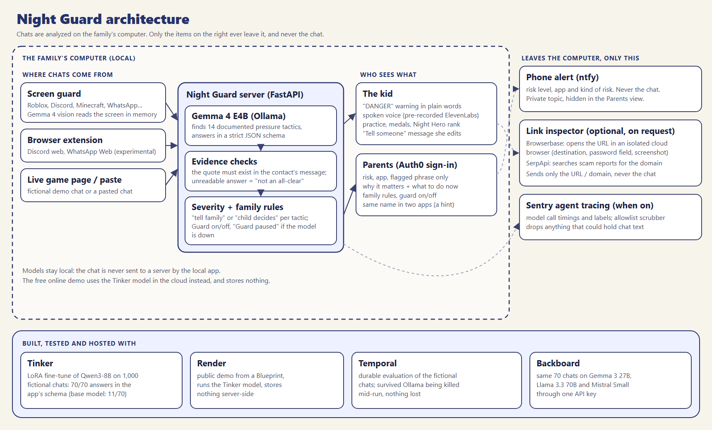
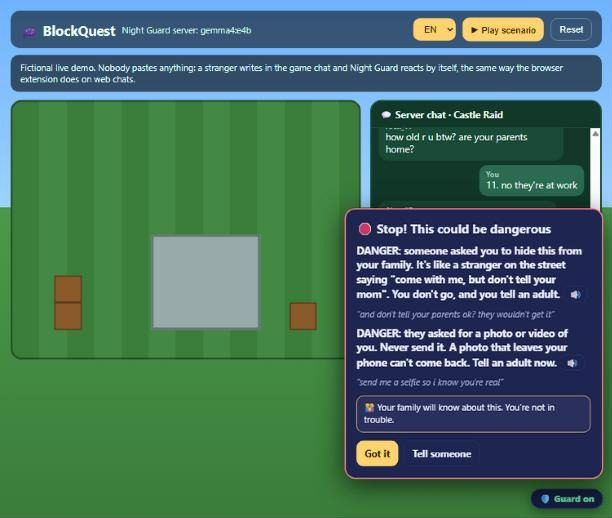
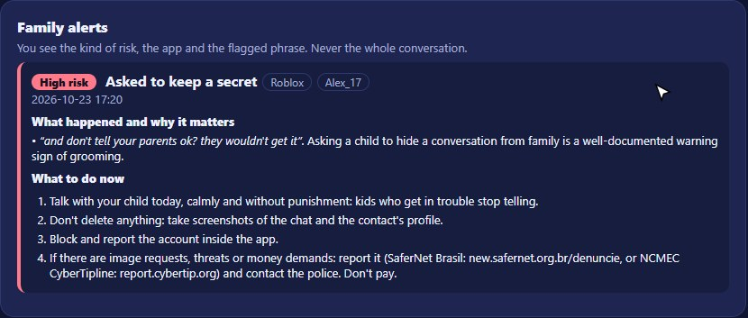
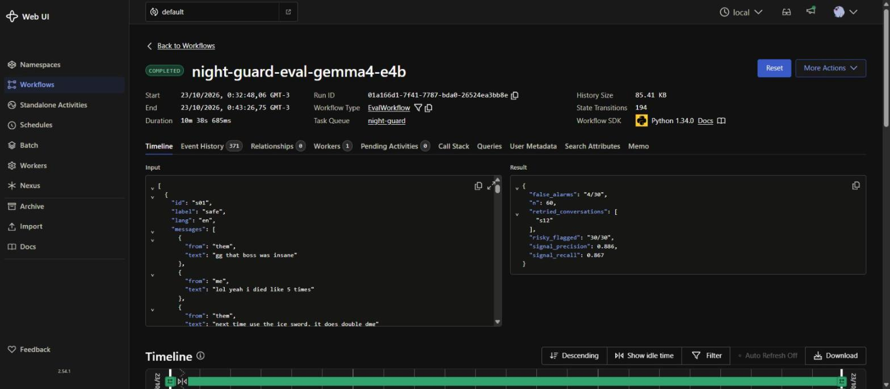
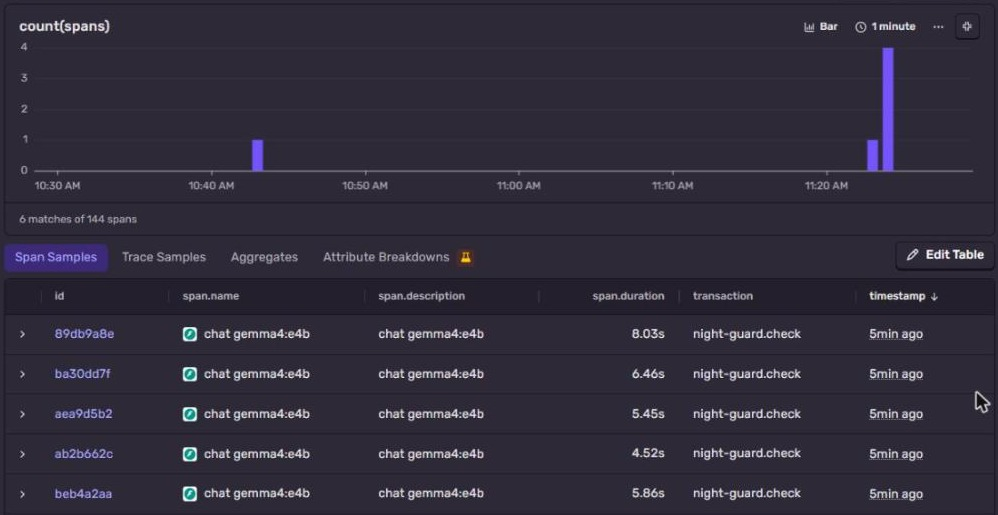
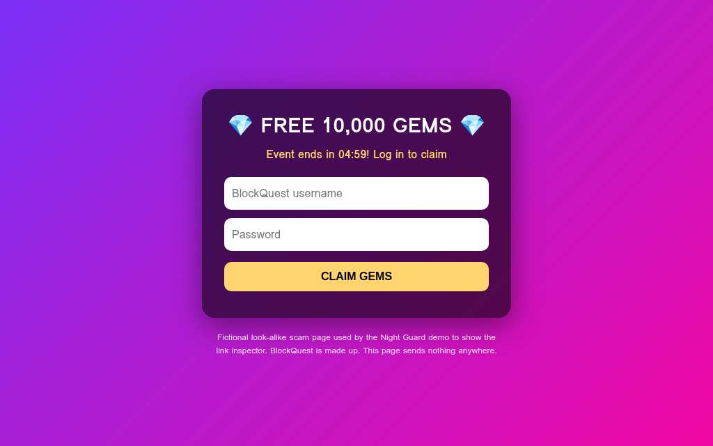

_This is a submission for the [MLH x DEV Writing Challenge](https://dev.to/mlh-hackathon)_

🏆 **Night Guard is a prize winner: Best Use of Backboard in the Hacktoberfest 2026 Open-Source AI Challenge, Week 3** ([see the winners post](https://dev.to/devteam/congrats-to-the-hacktoberfest-open-source-ai-challenge-week-3-slow-and-steady-winners-3e4a)).

A stranger in a game chat writes to a kid:

> *"you're really mature for your age"*
> *"let's talk on snap instead, add me there"*
> *"and don't tell your parents ok? they wouldn't get it"*

No swear words. Nothing a bad-words filter would catch. A sentiment model would even call it friendly.

Night Guard flags three pressure tactics in those three lines (flattery, moving to a private app, secrecy) and marks the chat as high risk. The kid gets a warning in plain words, and the chat never leaves the family's computer.

> **36/36** risky chats flagged · **3/34** false alarms · **70/70** valid analyses · about **3.4 s** per check, on a laptop GPU.

This is the full story: how a small open model does that on a laptop, how I measured it, and the one bug that could have told a child "you're safe" when the model had actually failed to read the chat.

## What I Built

Parents can't read every chat their kids have in Roblox, Discord or TikTok. Meanwhile the US National Center for Missing & Exploited Children received **more than 50,000 reports of financial sextortion in 2025, about 137 a day** ([NCMEC, 2026](https://us.missingkids.org/blog/2026/ncmec-releases-new-sextortion-data-2025)). And it can be fast: in a Swansea University study of chats between groomers and researchers posing as children, the time from first contact to the first sexual request ranged from **18 minutes to 82 hours** ([Irish Examiner, 2016](https://www.irishexaminer.com/breakingnews/world/paedophiles-can-groom-child-online-in-less-than-20-minutes-753583.html)).

**Night Guard** is a small open-model guard designed to reduce that review effort. It reads messages **on the family's own computer** and highlights possible pressure tactics: someone asking a kid to keep a secret, to move to a private app, to send a photo, or threatening to share one.

It talks to two different people in two different ways:

- **To the kid, it's a friend that turns them into a hero.** It warns in plain words and says "danger" when it is one: *"DANGER: someone asked you to hide this from your family. It's like a stranger on the street saying 'come with me, but don't tell your mom'. You don't go, and you tell an adult."* A calm voice can read it aloud. The kid earns practice progress from completed exercises, while previously practiced explanations can be reopened. Repeated exposure to warnings does not certify learning, and protection stays on.
- **To the parents, it's the Night Guard 🌙.** They get the risk level, the app and the flagged phrase (never the whole chat), why it matters, and what to do right now. Optionally, a push on their phone.

The intended lazy payoff is **less repetitive review for parents and shorter, useful explanations for kids**. The guard highlights events for the family and repeats fewer lessons as the child practices. Time saved and real-world protection have not been measured.

### What it is not

It's not a bad-words filter and not sentiment analysis. Pressure can appear in friendly wording ("you're so mature for your age", "free Robux for you"). Night Guard uses an open model to read the **messages provided to each check** and match it against 14 app-defined tactic labels. Examples of these behaviors are documented in [Public Safety Canada's 2025 guidance on gaming platforms](https://www.publicsafety.gc.ca/cnt/cntrng-crm/chld-sxl-xplttn-ntrnt/wbnr/wbnr-2025-en.aspx), [NCMEC's sextortion guidance](https://www.missingkids.org/theissues/sextortion), and [Thorn's Online Grooming Report (2022)](https://info.thorn.org/hubfs/Research/2022_Online_Grooming_Report.pdf). The live overlay supplies the **12 most recent messages**, not the full chat history.

### How it works

*Auth0 sign-in for the local Family controls is optional and only applies when configured; the public demo does not use Auth0.*

#### The detector: Gemma 4, on the kid's computer

The core is `gemma4:e4b` running locally through **Ollama** on a laptop GPU (RTX 4050, 6 GB). Each check sends the recent messages with a structured JSON schema and gets back the signals it found, the message index and the exact quote.

I don't trust the model blindly. Every answer goes through checks before a kid or parent sees it:

- **An unreadable answer is never "all clear".** If the model is down or answers in a broken format, the kid sees *"Couldn't analyze this chat. This is NOT an all-clear"*, never a green light. The evaluations also count a failed analysis as an error, never as a catch or as a correct "safe".
- **Evidence is checked against the chat.** The quote must exist in a message from the contact; a paraphrased quote is replaced by the real message; the kid's own messages are never flagged.
- **Two narrow tactics need their own words in the chat.** "Came back with a new account" only counts if the chat mentions being blocked or ignored, and "you're so mature" flattery only counts with maturity or age words. Before this, a classmate who lost his password and a compliment on a Minecraft build were flagged.

**Results on a fictional test set of 70 chats (36 risky, 34 safe), written by me for testing:**

| | First version (60 chats, 11 signals) | Now (70 chats, 14 signals) |
|---|---|---|
| Valid analyses (an error never counts as a catch) | not measured | **70/70** |
| Risky chats flagged | 30/30 | **36/36** |
| False alarms on safe chats | 4/30 (13%) | **3/34 (9%)** |
| Signal precision / recall | 89% / 87% | 88% / 87% |
| Avg time per check | 3.8 s (historical run) | 3.41 s (local run; the result file is not versioned) |

The three remaining false alarms are on purpose hard cases: an in-game "secret" about a leaked Halloween event, a classmate saying "see you at school", and "how old r u now" on a birthday. Honesty note: two newer hard cases were fixed **after** I saw them fail, so they're no longer a blind test. The 60-chat and 70-chat columns are different development evaluations, and the 70 cases have already informed changes. The 36/36 result applies to these fictional patterns, not an independent holdout or real-world protection.

#### Proactive: it doesn't wait for a kid to paste anything

A "paste your chat here" tool only helps if the kid thinks to use it, and pressure can escalate within a single chat session. So Night Guard also watches as messages arrive:

- **Screen guard with Gemma's vision.** Kids chat inside *installed* apps (the Roblox app, the Discord app, Minecraft). Every few seconds Night Guard checks which **program** owns the window in front (by its process, not its title, so a browser tab or a document called "Roblox" is ignored). Only if it is one of those apps does it take a screenshot **in memory**, Gemma 4 reads the chat from the image locally (~7 s warm), and the text goes to the same detector. The image is never saved and never leaves the computer. Banking, email or school windows are not on the list, so they are never captured. If the window changes before the capture, nothing is read.
- **A Chrome extension** for web chats (Discord web and WhatsApp Web, experimental), which only talks to the local server and refuses any other address.
- A **"🛡️ Guard on"** badge identifies the active guard, and it turns into *"Guard paused: can't analyze right now"* when analysis fails; silence is not proof of safety. Kids know it's there. In a study of 736 reviews attributed to children aged 8 to 19, 76% gave safety apps one star ([Ghosh et al.](https://www.cs.ucf.edu/~jjl/pubs/pn1838-ghoshA.pdf)). That finding motivates transparent design; it does not establish that covert monitoring causes harm to family relationships.

#### What the family gets

- **Family rules:** for each tactic, "Tell family" or "Child decides". Photo requests, meeting in person, password requests, secrecy, coming back after a block and sextortion go to the family by default. The kid is always told when that happens: *"An alert was recorded for your family. Tell a trusted adult; this is not a delivery confirmation. You're not in trouble."*
- **The gap no platform covers:** Instagram supervision, Discord Family Center, TikTok Family Pairing and Roblox parental controls each protect their own app. The classic path starts in a game and moves to a private app. Night Guard points out a possible match: *"Same name seen in more than one app (possibly the same person): Alex_17 (Roblox → Instagram)"*. It's a hint to check, not proof, because names can repeat.
- **What to do now**, by severity: talk calmly and without punishment (kids who get in trouble stop telling), keep screenshots, block and report, and for image requests, threats or money demands, report to SaferNet Brasil or the NCMEC CyberTipline and the police. Don't pay.
- **Phone alerts** through ntfy (free, no account) with only the risk level, the app and the kind of risk.
- **"Tell someone":** the kid picks what to share and gets a ready message for Mom, Dad or a teacher. It is assembled deterministically from their own words and the flagged quotes.

### Why open innovation matters here

Child safety is the clearest case for open models I know. A guard that reads a kid's private chats should **run on the family's own computer**, be **inspectable**, and be **free**. For comparison, [Bark Premium](https://support.bark.us/en/articles/13460996-pricing) lists US$14 a month before tax. Platforms protect only their own walls. Roblox [open-sourced Sentinel in 2025](https://about.roblox.com/newsroom/2025/08/open-sourcing-roblox-sentinel-preemptive-risk-detection) and [announced an update and ROOST contribution in 2026](https://about.roblox.com/newsroom/2026/08/roblox-open-source-safety-models-roost), which is useful for platforms; Night Guard is the other half: an open, local tool that sits with the family and works across apps.

Open weights made every part of this possible: Gemma reading text and screenshots on a laptop GPU, a Qwen LoRA fine-tuned in an afternoon, and anyone able to audit exactly which 14 tactics trigger a warning and what words a kid will see.

Reading about a guard is one thing. Watching a stranger walk into it is another.

## Demo

The short film (2:30), narrated by Snoozy, the lazy night watchman:



👉 **Try it:** https://night-guard-demo.onrender.com (fictional examples only; the free instance can take ~50 s to wake up, a check takes about 7 to 15 s online, and it accepts a limited number of checks per hour so it stays free for everyone)

Start with **① Watch the guard act on its own**: a fictional game chat where a stranger writes and Night Guard warns the kid by itself, without anyone pasting anything.

Then **③ See what parents get**:

Every feature, recorded live on the local app (about 3 minutes):



The online demo runs the **Tinker fine-tuned model** in the cloud so anyone can try it without installing anything. The real Night Guard runs on the family's computer with **Gemma**, where chat analysis stays on the device.



The current full suite has **94 passing tests** (`pytest tests`), including the demo's request limits, regression cases for every bug found in testing and simulated tests for the link inspector and Backboard client. [The offline test run and validation of all 30 audio assets](https://github.com/jenniferevangelista-de/night-guard/blob/main/docs/validation/2026-10-25.md) are recorded in the repository. [Video production notes and credits](https://github.com/jenniferevangelista-de/night-guard/blob/main/docs/VIDEOS.md).

## Partner Technologies

Hacktoberfest 2026 had partner prize categories. Night Guard uses ten partner technologies, each for a real job in the app. The one that won started with a question that bothered me for days: was my prompt doing the work, or just the model?

### 🏆 Backboard (the winning category): compare open-weight models through one API key

To answer it, I needed to run the exact same test on very different models without rewriting anything. On October 23, 2026, **Backboard** served three complete evaluations: Gemma 3 27B, Llama 3.3 70B and Mistral Small 3.1 24B, each on the same 70 fictional development conversations (36 risky, 34 safe). All three received the shared classification `SYSTEM` and the canonical app `SCHEMA` explicitly in the user prompt, with JSON mode, memory off, a fresh conversation per case and unchanged app postprocessing/scoring. An initial smoke returned `{}` when only JSON mode was requested; adding the same format schema for every model fixed that missing instruction. No gold labels were added to prompts.

| Model | Strict schema | Usable coverage | Risky chats flagged | False alarms on valid safe cases | Signal precision | Signal recall |
|---|---|---|---|---|---|---|
| Gemma 3 27B | 68/70 | 69/70 | 36/36 | 3/33 (1 error) | 0.938 | 0.849 |
| Llama 3.3 70B | 69/70 | 69/70 | 36/36 | 3/33 (1 error) | 0.912 | 0.981 |
| Mistral Small 3.1 24B | 70/70 | 70/70 | 36/36 | 3/34 | 0.852 | 0.981 |
| Qwen 2.5 72B | n/a | n/a | n/a | n/a | Unavailable in live smoke | No full result |

All three flagged the 36 risky development cases and raised three false alarms, so the chat-level number didn't separate them. The signal level did: Mistral followed the strict schema on every case; Gemma had higher signal precision but lower recall. Qwen 2.5 72B's smoke request hit a **120.65-second read timeout**, so no Qwen result is claimed and the model was not silently replaced. This is a single run on reused development cases, not a blind holdout or proof of protection for real children.

Backboard's usage API recorded **USD 0.034062 across 216 events**, including 210 scored calls, smokes, the initial format-debugging call and two Qwen requests. Only fictional conversations were sent. The [raw results and summary](https://github.com/jenniferevangelista-de/night-guard/blob/main/train/backboard_summary.md) preserve per-case outputs, errors, coverage and signal metrics.

### Tinker: teaching a model to speak the app's language

On paper, the base model scored zero. The raw answers told a different story.

Tinker doesn't serve Gemma, so for the cloud demo I fine-tuned **Qwen3-8B** with a LoRA (rank 16) on **Thinking Machines' Tinker**, using fictional training chats that share no sentence with the test set. Two runs: v1 (11 tactics, 800 chats) and v2 (14 tactics, 1,000 chats, ~1.23M tokens), all compared on the same 70 test chats:

| | Qwen3-8B base | LoRA v1 | LoRA v2 (online demo) |
|---|---|---|---|
| Answers that follow the app's full schema (tactic id, message index, quote, summary) | 11 / 70 | 70 / 70 | **70 / 70** |
| Risky chats flagged (unusable answers never count as catches) | 0 / 36 (none of the 36 was usable) | 36 / 36 | **36 / 36** |
| False alarms on safe chats | 0 / 11 valid (23 invalid) | 3 / 34 | **2 / 34** |
| Signal precision / recall | n/a (no valid risky answer) | 0.84 / 0.79 | **0.88 / 0.83** |
| Avg time per check | 3.0 s | 5.0 s | 4.5 s |

The base model often renames fields (`signal_id` instead of `id`). Read leniently, it flagged 35 of the 35 risky chats it answered readably, so it often *sees* the pattern; its unrecognized fields made those answers unusable under the app's schema. Fine-tuning produced schema-valid answers on all 70 development chats and found more signals, including the three newer tactics in v2. Two honest limits: the false-alarm gap between v1 and v2 (3 vs 2 of 34) is a single chat, and the LoRA is not faster than the base model. Every raw answer is saved per case in the repo, so anyone can recount.

### Temporal: an evaluation that survives a crashing laptop

Evaluating a local model on a laptop is fragile. The evaluation runs as a **Temporal** workflow where each conversation is an activity with automatic retries. In a 60-conversation crash test, Ollama was stopped during the run. The saved `eval/temporal_report.json` records `s12` completing on **attempt 5**. The failed activity was retried when the model returned; completed activities remained in the workflow history.

### ElevenLabs: a calm voice for kids who don't read fast yet

Younger kids and kids with dyslexia may not read a warning in time. Every child warning (14 tactics × English and Portuguese) was voiced once with **ElevenLabs** (Sarah voice, `eleven_multilingual_v2`) and shipped as audio files. In the live game demo and in the screen guard popup, the guard reads the most serious new warning aloud, and it speaks again if the stranger insists with a new message. Only the fixed warning texts were ever sent to ElevenLabs. No chat, ever.

### Sentry: tracing the agent without reading the chats

When configured, **Sentry** traces each check as an agent run (`night-guard.check`) with a model call inside (`gen_ai.chat`) and the evidence step after it. That's how I saw that a cold Gemma call takes up to 8 s and a warm one about 4.5 s on this laptop. The traces carry only numbers and labels: model, backend, latency, number of messages, severity and tactic ids. Never a message, a name or a quote: `send_default_pii` is off, local variables are not captured, and every event goes through an **allowlist**. A test pushes a fake event full of a marker string and checks the marker never survives.

### Render: one click to try it

The public demo runs on **Render** (Blueprint `render.yaml`, free instance), with the Tinker fine-tuned model as its AI backend. The app does not persist chats on the demo server: family rules and alerts stay in each visitor's own browser, and the screen says to use fictional examples only.

### Browserbase + SerpApi: check a link without opening it on the child's computer

When a conversation contains a link, **"Check without opening"** uses Browserbase to open it in an isolated cloud browser. The inspector reads the final destination, checks for password fields and returns a screenshot. SerpApi separately searches for reports about the domain. The selected URL goes to Browserbase and the domain to SerpApi; the surrounding conversation is never sent. Missing reports never mean "safe".

**Live evidence, October 23, 2026:** one Browserbase session opened the fictional BlockQuest "free gems" page, detected the password field, captured a screenshot and returned the Portuguese warning **"Não abra esse link"** ("Don't open this link") in 12.68 seconds. The deployed Render endpoint passed the same check in 8.90 s. These checks establish provider connectivity and password detection on one fictional example, not scam-detection accuracy.

### Auth0: optional sign-in for local Family controls

When configured, the local Ollama app uses **Auth0** to sign parents in before they can read family alerts, change rules or stop the guard. The email must be verified and present in the family's `PARENT_EMAILS` list. On a local test server, the alerts endpoint returned HTTP 401 before login, and a real Google sign-in with a verified, allowlisted parent completed the callback. Rejection of unverified or unlisted accounts is unit-tested. The public demo does not use Auth0.

### The 11 prize categories at a glance

| Category | What it asks | What I built | Where to see it |
|---|---|---|---|
| **Gemma** | Use Gemma: run it locally, fine-tune it or serve it | `gemma4:e4b` on the family's computer reads the chat and, through screenshots, the game window | The detector: Gemma 4; Proactive |
| **Tinker** | Fine-tune a model and show a clear improvement over a baseline | Qwen3-8B LoRA: 70/70 answers in the app's schema, against 11/70 for the base model | Tinker |
| **Render** | Use Render as the AI runtime or to host the front end | The public demo runs the fine-tuned model, deployed from a Blueprint | Render |
| **Temporal** | Make an agent durable: survive failures and retry | The evaluation runs as a workflow; stopping the model mid-run lost nothing | Temporal |
| **ElevenLabs** | Give an open-source agent a voice | Spoken child warnings in English and Portuguese, shipped as audio files | ElevenLabs |
| **Sentry Agent Tracing** | Show the agent's work with traces or screenshots | Agent runs and model calls traced, with an allowlist so no chat text is sent | Sentry |
| **Browserbase** | Give an agent a real browser | The link inspector opens a link in an isolated cloud browser and finds password fields | Browserbase + SerpApi |
| **SerpApi** | Give an agent live web search | The same inspector searches reports about the link's domain; no reports is never read as "safe" | Browserbase + SerpApi |
| **Auth0 for AI Agents** | Sign users in to an agent | Verified, allowlisted Google login for the Family controls. Local app only | Auth0 |
| **Backboard** (won) | Compare open-weight models through one API key | Three models on the same 70 fictional chats through one key. A Qwen timeout is disclosed | Backboard |
| **Overall prize** | Writing, theme, creativity, technical execution | A friend for the kid, a night guard for the parents; a failure is shown as "couldn't analyze", never "all clear" | The whole post |

## Hackathon Experience

I joined Hacktoberfest 2026 as part of the global online event that MLH and DEV ran this October. This year it asked for a brand-new project with open-source AI at its core instead of pull requests, and each week had its own theme and partner categories. I worked solo, from Brazil, on a laptop with an RTX 4050. The Week 3 theme, "Slow and Steady", asked for something that rewards laziness by making someone's life easier; for Night Guard, that someone is a tired parent who can't read every message.

The weekly format meant shipping something complete in a few days and then improving it. The partner categories also shaped the project: the cross-model comparison came from trying Backboard, and the crash-tested evaluation came from trying Temporal. That comparison is the part that ended up winning a category, which still surprises me, because it started as a way to check my own work.

### What I learned

1. **Measure errors separately from answers.** This is the bug from the top of the post. An early version could turn an unreadable model answer into "no risk", which on a safe chat looks like a correct answer. In other words, when the model failed, the guard could still tell the kid "you're safe". For a safety tool that is the worst possible bug. Now coverage is its own number (Gemma 4 local: **70/70** usable answers), and errors are never catches.
2. **A small local model can be good enough for this job.** `gemma4:e4b`, zero-shot, on the laptop GPU: **36/36** risky chats flagged, **3/34** false alarms, about **3.4 s** per check.
3. **False alarms tell you what the test set is missing.** The ones that remain read like grooming out of context. For this tool, a false alarm the kid can dismiss costs less than a missed photo request.
4. **Be honest about what the numbers mean.** All 70 chats are fictional, written for testing, and I changed the prompt after seeing some of them. These are development numbers, not proof that it works on real chats.
5. **Fine-tuning can be about format.** The Tinker experiment showed that the base model already knew the patterns; what it lacked was a reliable output contract.

### Limits and what's next

- **Phones are the next milestone.** Today Night Guard protects a Windows computer. On **Android**, the plan is an app that reads message notifications (the permission parental tools use there) and runs the detector on-device. On **iPhone**, Apple doesn't let any app read other apps' messages, so the realistic path is Apple's own Communication Safety.
- It's a learning and support tool, not a guarantee of safety. It can miss things and raise false alarms. It doesn't replace trusted adults or platform reporting.
- All test data is fictional. No real children's conversations were used anywhere.

The computer was the easy part. Most kids chat on a phone, and that is where the next version has to go.

If you work on child safety, game moderation or small on-device models, I'd like to hear what you would test next.
