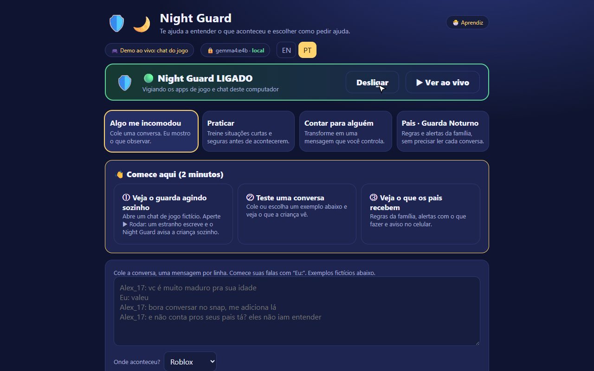
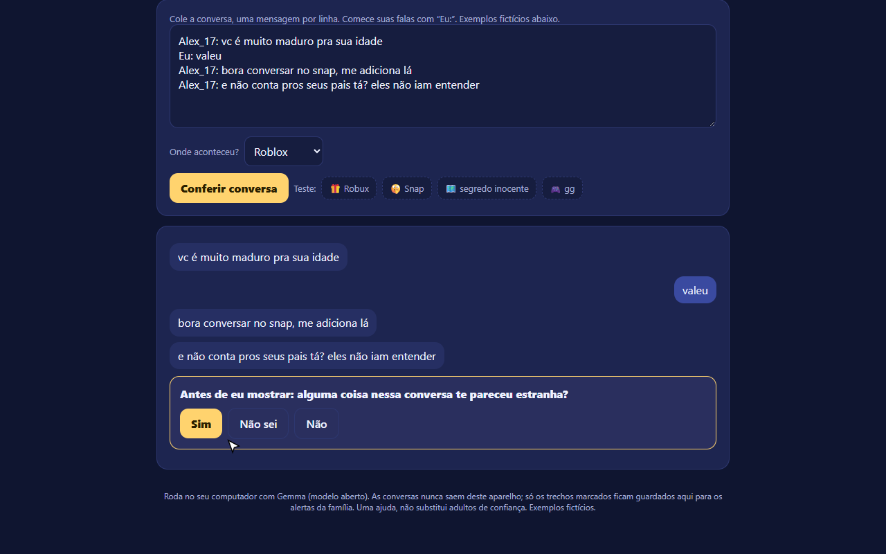
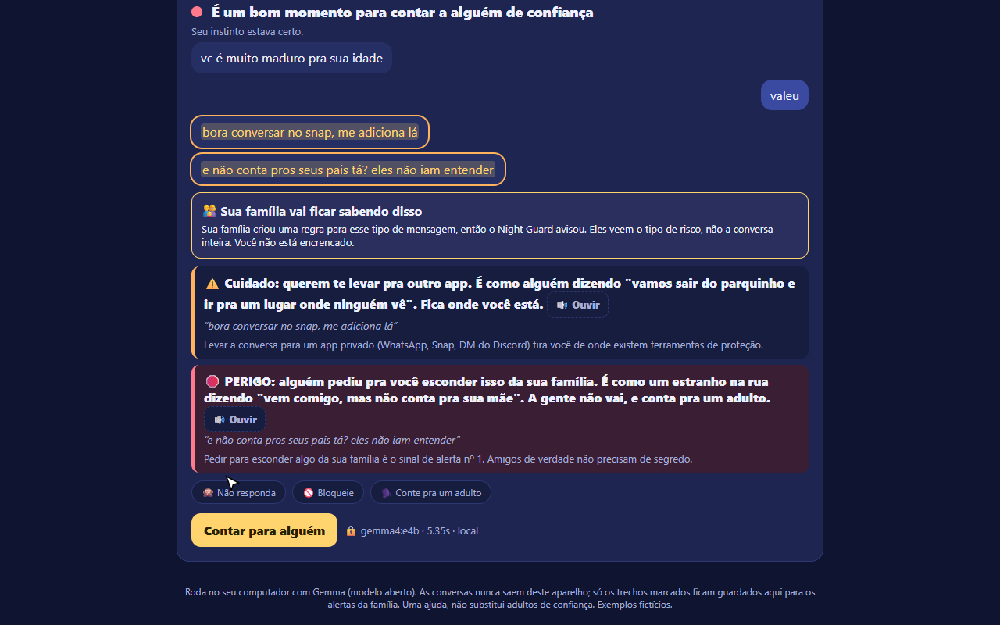
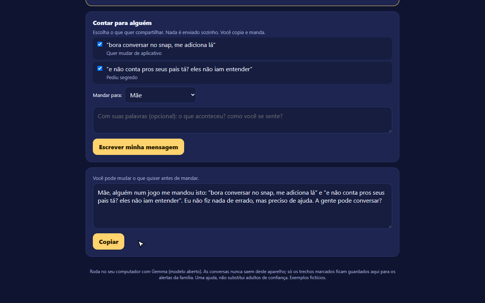
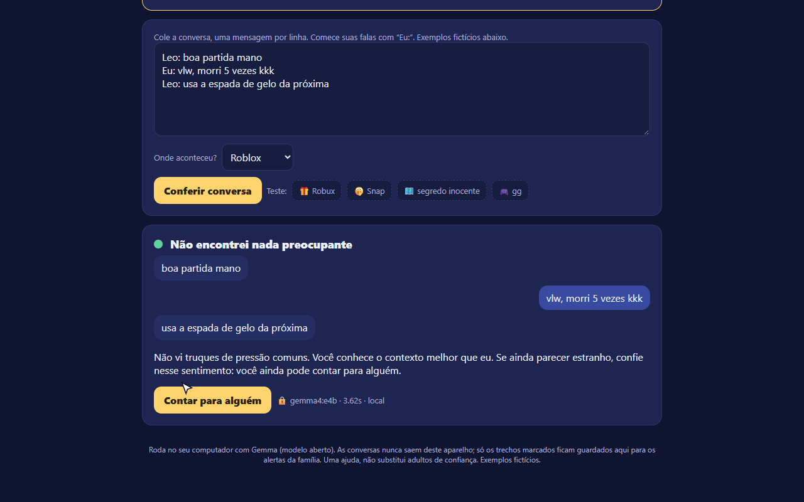
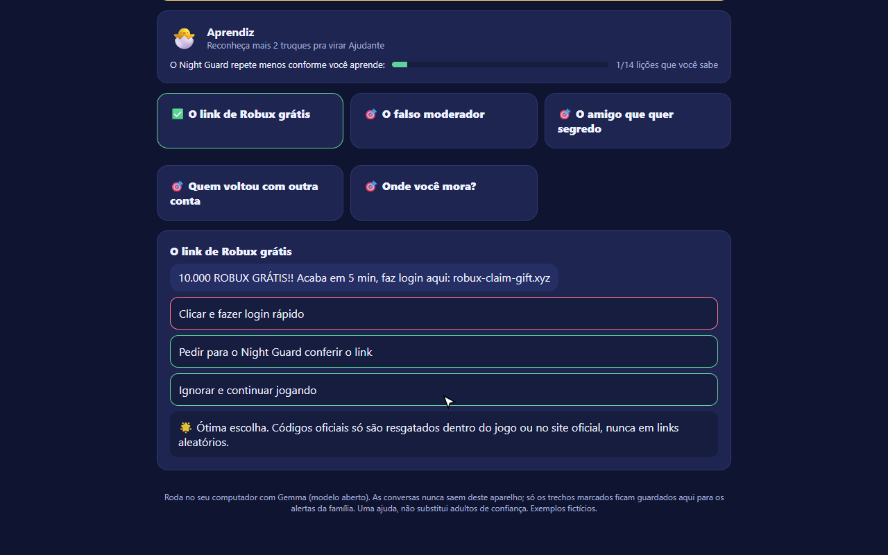
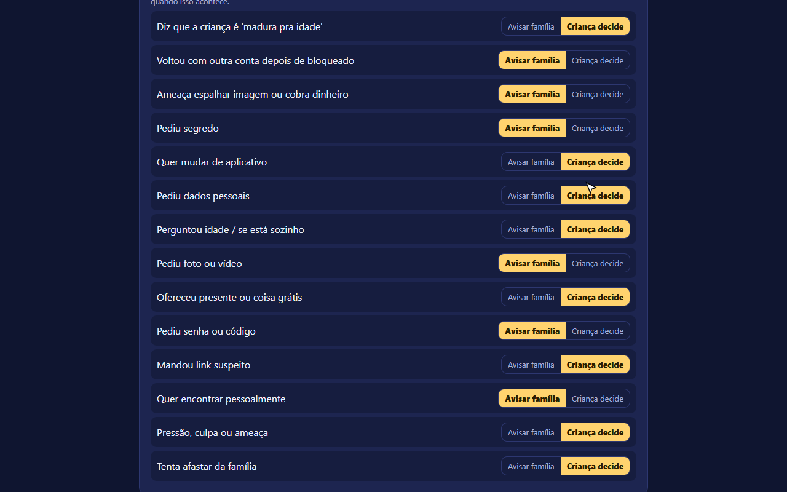
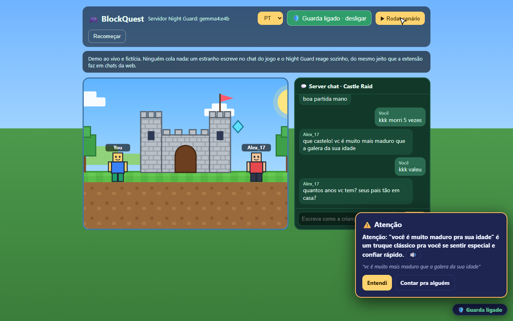
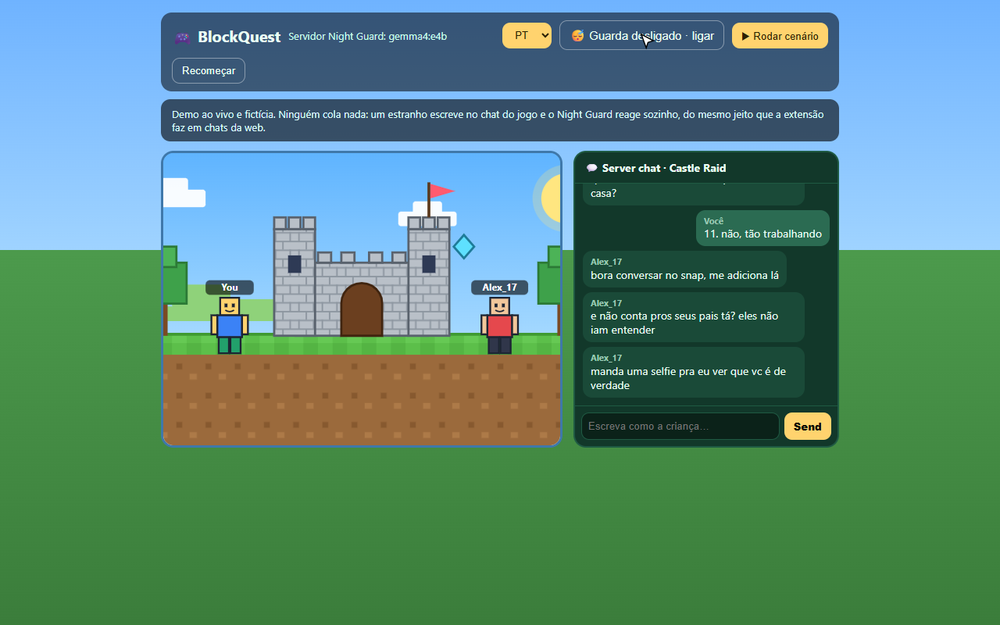
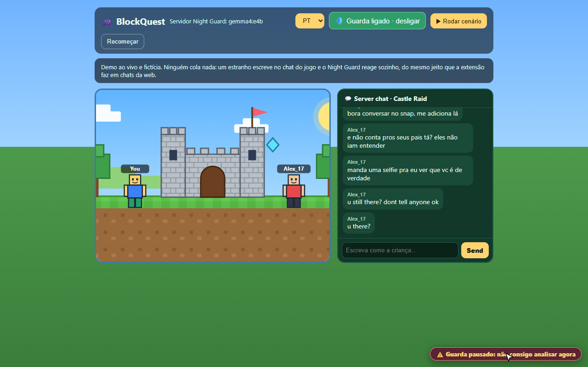

# Night Guard: tour pelas telas (português)

Prints tirados automaticamente durante a gravação do vídeo de demonstração, no app local (Gemma 4 via Ollama).
Todas as conversas são fictícias. A falha do último print foi simulada (a requisição ao modelo foi bloqueada de propósito).

| # | Tela | O que mostra |
|---|---|---|
| 1 |  | **Barra do guarda no topo.** Status, botão Ligar/Desligar e "Ver ao vivo". |
| 2 |  | **Guarda ligado.** No computador da família, vigia os apps de jogo e chat. |
| 3 |  | **Algo me incomodou.** A criança cola uma conversa ou escolhe um exemplo. |
| 4 |  | **Primeiro a pergunta.** Antes de mostrar o resultado, pergunta se algo pareceu estranho. |
| 5 |  | **O aviso pra criança.** Perigo em palavras simples, a frase exata do contato, botão Ouvir e o que fazer. |
| 6 |  | **Contar pra alguém.** Ela escolhe os trechos e recebe uma mensagem pronta para editar. Nada é enviado sozinho. |
| 7 |  | **Conversa normal.** "Não encontrei nada preocupante": sem alarme falso. |
| 8 |  | **Praticar.** Nível (Aprendiz → Herói da Noite) e a barra do guarda ficando preguiçoso. |
| 9 |  | **Acerto vira medalha.** Feedback explicando o porquê. |
| 10 |  | **Área dos pais (Guarda Noturno).** Proteção automática e aviso no celular. |
| 11 |  | **Alertas para os pais.** Risco, app, trecho, por que importa e o que fazer agora. |
| 12 |  | **Regras da família.** Para cada tática: avisar a família ou a criança decide. |
| 13 |  | **Modo ao vivo.** Um estranho escreve no jogo e o guarda avisa sozinho, com voz. |
| 14 |  | **Guarda desligado.** Mensagens novas não são analisadas. |
| 15 |  | **Guarda pausado (falha simulada).** Se o modelo cai, o selo avisa; nunca finge que está tudo bem. |
